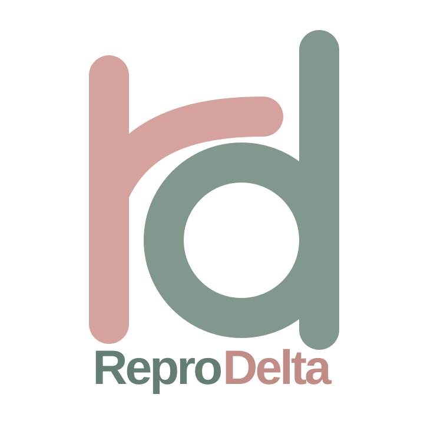
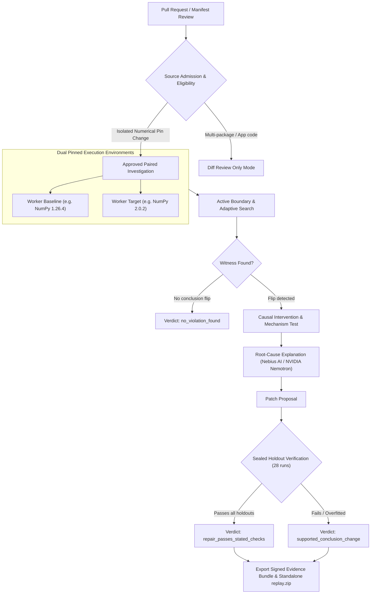

<p align="center">
  
</p>

<p align="center">
  <strong>Automated differential verification and forensic evidence for silent scientific conclusion regressions after dependency upgrades.</strong>
</p>

<p align="center">
  <a href="https://github.com/Gracy769/reprodelta/actions"></a>
  <a href="https://www.python.org/downloads/"></a>
  <a href="https://fastapi.tiangolo.com/"></a>
  <a href="https://www.postgresql.org/"></a>
  <a href="https://docker.com"></a>
  <a href="LICENSE"></a>
</p>

---

## Overview

Scientific Python workflows face an insidious mode of failure: **a dependency upgrade completes without crashing, existing unit tests pass, yet the scientific conclusion silently flips.**

Standard CI/CD systems only verify that code executes without runtime exceptions. They cannot detect when upstream changes in floating-point casting, numerical tolerances, or linear algebra backends introduce subtle precision drift that crosses domain-specific decision thresholds.

**ReproDelta** solves this by performing automated differential verification between dependency baselines:
- **Executes identical immutable inputs** across dual pinned worker environments.
- **Actively searches for decision-boundary witnesses** (inputs that trigger conclusion changes).
- **Isolates causal mechanisms** through controlled counterfactual interventions.
- **Validates LLM-proposed code repairs** against sealed, immutable holdout suites.
- **Generates verifiable forensic evidence bundles** complete with self-contained replay scripts.

---

## Architecture & Investigation Lifecycle

ReproDelta connects to GitHub and GitLab pull requests, analyzes dependency manifests, executes paired differential workloads in isolated sandboxes, and synthesizes root-cause evidence.



---

## Core Capabilities

### 1. Dual Pinned Worker Isolation
Differential verification requires bit-identical host consistency. ReproDelta executes executions in parallel sandboxes:
- **Baseline Worker**: Locked to legacy environment specifications (e.g., Python 3.12 + NumPy 1.26.4).
- **Target Worker**: Locked to upgraded environment specifications (e.g., Python 3.12 + NumPy 2.0.2).
- Zero-trust security: Sandboxes run unprivileged with network disabled, read-only root filesystems, memory/PID caps, and ephemeral `/tmp` volumes.

### 2. Active Boundary & Adaptive Search
Standard tests rarely hit the exact floating-point values where precision shifts alter a decision threshold. ReproDelta employs:
- **Deterministic Float32 ULP Sweep**: Iterates `np.nextafter` floating-point steps near domain decision boundaries.
- **Seeded Pseudo-Random Search**: Explores bounded input distributions defined by the approved contract.
- **Adaptive Boundary Interpolation**: Measures output distances from the decision threshold and zooms in on precision cliff-edges.

### 3. Causal Counterfactual Interventions
Finding a difference is not enough—scientists need the *why*. ReproDelta tests the suspected root cause (e.g., NumPy NEP 50 scalar promotion) by injecting controlled counterfactuals (e.g., forcing explicit `float32` divisors) to test whether the behavior disparity vanishes when arithmetic rules are unified.

### 4. Sealed Holdout Repair Verification
To prevent LLMs from generating overfitted patches that merely hardcode the failing witness input, ReproDelta:
- Seals an immutable set of holdout inputs *before* prompting the model.
- Applies candidate diffs only to ephemeral, hashed in-memory copies inside workers.
- Executes 28 independent verification runs across baseline and target environments.

### 5. Self-Contained Replay Bundles
Every completed investigation exports a cryptographically verifiable JSON evidence bundle and an owner-downloadable `replay.zip` containing:
- Exact source code snapshot at base and head commits.
- Precise input arrays and observed floating-point outputs.
- Standalone POSIX and Windows `replay.py` scripts for local, third-party reproduction.

---

## The Scientific Demonstration Case: NumPy NEP 50

ReproDelta includes a constructed demonstration classifier (`fixture/project/pipeline.py`) exposing the real-world precision changes introduced in **NumPy 2.0 (NEP 50 - Promotion of Scalars)**:

```python
# NumPy 1.26: float32 scalar / Python float -> float64 (upcast)
# NumPy 2.0:  float32 scalar / Python float -> float32 (preserved, no upcast)
normalized = np.array([sample / 2.0 for sample in signal])
power = normalized ** 2
ratio = float(np.sum(power[mid:]) / np.sum(power))
conclusion = "above_threshold" if ratio > 0.5 else "below_threshold"
```

### The Boundary Witness
At the boundary threshold (`0.5`), the difference between intermediate `float64` summation vs `float32` single-precision rounding flips the outcome on identical raw signal data:

```python
# Exact witness input discovered by ReproDelta:
signal = [1.0, 1.0, 1.0, 1.0, 1.0, 1.0, 1.0, 1.0000001192092896]

# NumPy 1.26.4 (float64): ratio = 0.5000000149... -> "above_threshold"
# NumPy 2.0.2  (float32): ratio = 0.5000000000... -> "below_threshold"
```
**Outcome:** The code runs cleanly without errors, but the published scientific conclusion silently inverts.

---

## Verdict Taxonomy

ReproDelta avoids simplistic "SAFE/UNSAFE" badges, providing formal, bounded verdicts:

| Verdict | Meaning |
|---|---|
| `supported_conclusion_change` | A reproducible conclusion change was confirmed on valid inputs across environments. |
| `repair_passes_stated_checks` | A proposed code repair successfully restored conclusion consistency across all sealed holdouts. |
| `no_violation_found` | No conclusion change was observed within the tested input domain and budget ceiling. |
| `observed_drift` | Numerical values drifted within acceptable tolerances without flipping the categorical conclusion. |
| `pre_existing_contract_violation` | Input rejected by domain preconditions prior to execution. |
| `inconclusive` | Conflicting within-environment repeats or insufficient evidence to confirm causality. |
| `setup_failure` | Environment initialization, manifest parsing, or worker connection failure. |

---

## Quickstart

### Option 1: Docker Compose (Recommended)

Run the complete stack with pinned dual workers and PostgreSQL:

```bash
# 1. Clone repository and set up environment
git clone https://github.com/Gracy769/reprodelta.git
cd reprodelta
cp .env.example .env

# Optional: Add your Nebius API Key in .env for live LLM root-cause analysis
# (Leave empty to run in deterministic Mock LLM mode)

# 2. Build and start services
docker compose up --build

# 3. Access workbench
# API & UI available at: http://localhost:8000
# OpenAPI Docs: http://localhost:8000/docs
```

### Option 2: Local Development (Python 3.12)

```bash
# 1. Create and activate virtual environment
python -m venv venv
source venv/bin/activate  # Or `venv\Scripts\activate` on Windows

# 2. Install package and dev dependencies
pip install -e ".[dev]"

# 3. Run automated test suite
python -m pytest tests/ -q

# 4. Start local development server
python -m uvicorn app.main:app --reload --port 8000
```

---

## Test Suites & Verification

ReproDelta maintains rigorous test coverage spanning contracts, sandboxing, determinism, and repair gates:

```bash
# Run complete Python test suite
python -m pytest tests/ -q

# Run frontend UI regression checks (Node.js)
node --test tests/frontend/*.cjs
```

### Key Verification Layers

| Test Layer | Focus |
|---|---|
| `tests/unit/test_validator.py` | Input validation contracts, bounds checks, schema enforcement |
| `tests/unit/test_search.py` | Analytical ULP sweeps, seeded random exploration, budget halts |
| `tests/unit/test_patch_verifier.py` | AST parsing, syntax validation, hunk application, sealed holdouts |
| `tests/unit/test_persistence.py` | PostgreSQL row-locking, crash recovery, immutable event logs |
| `tests/unit/test_project_eligibility.py` | Source-admission gating for pull request manifests |
| `tests/integration/test_investigation_flow.py` | End-to-end investigation pipeline (preflight → report) |

---

## Environment Configuration

Configure ReproDelta via environment variables (or `.env` file):

| Variable | Default | Description |
|---|---|---|
| `DATABASE_URL` | `postgresql+asyncpg://...` | PostgreSQL connection string |
| `ARTIFACT_DIR` | `/data/artifacts` | Directory for content-addressed evidence storage |
| `RUNNER_MODE` | `local` | `local` (in-process simulation) or `worker_http` (pinned containers) |
| `NEBIUS_API_KEY` | *(blank)* | Nebius Token Factory API key (blank = mock mode) |
| `NEBIUS_MODEL_ID` | `nvidia/Nemotron-3-Ultra-550b-a55b` | Model identifier for root-cause synthesis |
| `NEBIUS_BASE_URL` | `https://api.tokenfactory.nebius.com/v1` | Nebius OpenAI-compatible API base URL |
| `SECRET_KEY` | `change-me-in-production` | Session encryption and state signature key |
| `PERSIST_INVESTIGATIONS` | `true` | Persist evidence bundles to disk/database across restarts |
| `MAX_ACTIVE_INVESTIGATIONS` | `2` | Concurrent investigation throttle per process |
| `GLOBAL_DAILY_INVESTIGATIONS`| `200` | Global daily rate limit ceiling |

---

## Security & Isolation Model

- **Airgapped Sandboxes**: Pinned worker containers operate with all network access disabled (`internal: true`).
- **Secret Isolation**: Workers possess no access to database credentials, LLM API keys, or source control tokens.
- **Strict AST White-listing**: Repair diffs are screened for disallowed syntax, external imports, subprocess spawns, and unbounded loops.
- **Immutable Holdouts**: Holdout evaluation sets are hashed and sealed before any LLM prompt is constructed.
- **Content Integrity**: All inputs, source snapshots, and run artifacts are verified using SHA-256 digests.

---

## Documentation Index

Detailed specifications and architectural guides are available in [`docs/`](docs/):

- [Product Requirements](docs/product-requirements.md) — Problem statement, user personas, and acceptance criteria.
- [Source Architecture](docs/source-architecture.md) — System boundaries, data structures, and pipeline flow.
- [Connected Review & Replay](docs/connected-review.md) — GitHub/GitLab integration and source-admission rules.
- [Security Architecture](docs/security.md) — Threat model, sandbox boundaries, and credential hygiene.
- [Database & Storage](docs/database.md) — Relational schema, append-only event logs, and artifact layouts.
- [Testing & Release Gates](docs/testing.md) — Test matrices, deterministic mock harnesses, and verification.
- [Oracle VM Deployment](docs/oracle-vm-deployment.md) — Production setup for OCI Always Free instances with Caddy.
- [Railway Deployment](docs/railway-deployment.md) — Containerized deployment guide for Railway.

---

## License

ReproDelta is licensed under the [MIT License](LICENSE).
